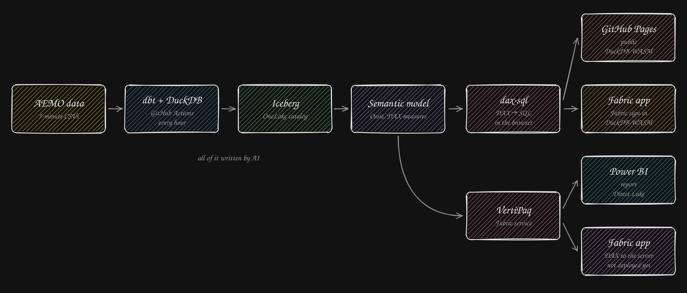

# Analytics as Code

An example of AI-driven analytics: every line here — ingestion, models, tests, pipelines,
semantic model, dashboards — was written by AI. The data is the Australian electricity
market (AEMO).

- **dbt + DuckDB** on GitHub Actions load the data into **Iceberg** tables, every hour.
- **One Power BI semantic model** ([`semantic_model/`](semantic_model/)) describes those
  tables: their relationships and the measures, in DAX.
- **One page** ([`dashboard/page/`](dashboard/page/)), the dashboard, written once, and
  the engines that run it ([`dashboard/`](dashboard/)); a host adds only how it reaches the
  data:
  - **GitHub Pages** ([live](https://nemtracker.github.io/), public,
    [`dashboard/github/`](dashboard/github/)): DuckDB-WASM in the browser, on a cached copy
    of the tables.
  - **Microsoft Fabric apps** (Fabric sign-in, [`dashboard/fabric_app/`](dashboard/fabric_app/)):
    [`iceberg/`](dashboard/fabric_app/iceberg/), DuckDB-WASM reading the Iceberg tables
    straight from the catalog, no copy; and [`vertipaq/`](dashboard/fabric_app/vertipaq/),
    the deployed semantic model as the engine (Power BI, Direct Lake), installed with the
    whole stack (lakehouse, dbt notebook and pipeline, model) into one Fabric workspace by
    `deploy_fabric.yml`.
- **Two ways of asking** ([`dashboard/page/`](dashboard/page/)): the page (the charts, the
  Logs tab) is the same, and only what it asks with differs.
  - [`dax/`](dashboard/page/dax/) asks the semantic model: a chart names the model's
    columns and measures, and [`query.js`](dashboard/page/semantic/query.js)
    writes that as DAX, and the DAX as SQL. Served at
    [nemtracker.github.io](https://nemtracker.github.io/).
  - [`sql/`](dashboard/page/sql/) asks the same model in SQL: each query a
    `SELECT … AGG("measure") … FROM model`, which the compiler reads into the same plan as
    a DAX query. Served at [nemtracker.github.io/sql](https://nemtracker.github.io/sql/). Its
    rows are checked against the DAX page's, question by question.
- **The compiler** is what lets the page read a Power BI model without Power BI: the page's
  queries become DAX ([`query.js`](dashboard/page/semantic/query.js)), and the
  DAX becomes SQL in [`dax-sql`](https://github.com/djouallah/dax-sql) (a submodule here), a general-purpose DAX
  compiler (by N.S. Devaraj): any Tabular model, DAX's filter context, context transition
  and relationships, with nothing written for this model or this page. Its SQL is checked
  against the SQL page and against the deployed model.

Details: [doc/ARCHITECTURE.md](doc/ARCHITECTURE.md)
